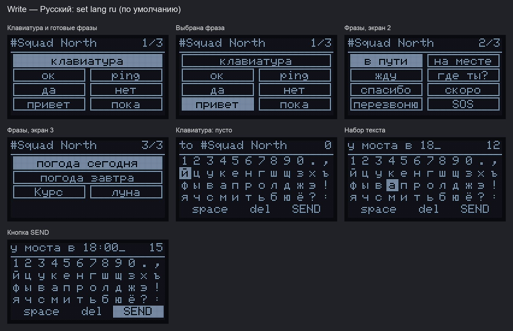
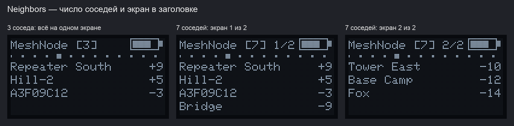

Прошивка companion для **Heltec T114, V3 и V4** на основе [TERMIN36/MeshCore](https://github.com/TERMIN36/MeshCore). Как пользоваться: [README](https://github.com/vladkondratyev/meshcore#readme).

## Что нового в v1.17.1-0.1.6

- **Второй экран готовых фраз.** Фраз стало 14. После последней фразы первого экрана фокус уходит на второй, номер экрана (`1/2`, `2/2`) — справа в заголовке.
  - `set lang ru`: ок, ping, да, нет, привет, пока · в пути, на месте, жду, где ты?, спасибо, скоро, перезвоню, SOS
  - `set lang en`: ok, ping, yes, no, hello, goodbye · on my way, arrived, waiting, where?, thanks, soon, call back, SOS
- **Neighbors.** В заголовке рядом с именем — число соседей и номер экрана: `MeshNode [7] 1/2`. Список листается целыми экранами раз в 3 секунды.
- **Прочтение только по кнопке.** Бегущая строка и телефон, забравший сообщение, больше не отмечают его прочитанным на устройстве. Окно сообщения не закрывается.
- В README описано, кто попадает в список адресатов Write: каналы устройства и избранные контакты.

## Отличия от TERMIN36

- **Бегущая строка (Msg scroll)** — включена сразу, выключается долгим нажатием на странице Msg scroll.
- **Write** — сообщение с устройства в канал или избранному контакту: готовые фразы или свой текст, русская и английская клавиатура, отметка `Delivered` для личных.

## Какой файл брать

| Плата | Файл |
|---|---|
| Heltec T114 | `Heltec_t114_companion_radio_ble…zip` |
| Heltec V3 | `Heltec_v3_companion_radio_ble…-merged.bin` для первой установки, `.bin` для обновления |
| Heltec V4 | `heltec_v4_companion_radio_ble…-merged.bin` для первой установки, `.bin` для обновления |

Сборки `_ble` — подключение к приложению по Bluetooth, `_usb` — по USB, `_wifi` — по Wi‑Fi (только V3 и V4).

В Wi‑Fi-сборках сеть задаётся при сборке: в готовых файлах это `myssid` / `mypwd`, порт TCP `5000`.
