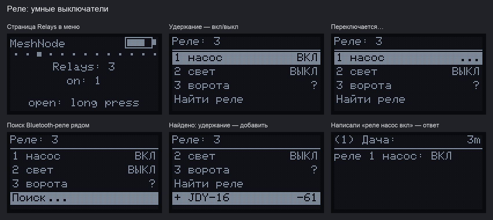

Прошивка companion для **Heltec T114, V3 и V4** на основе [TERMIN36/MeshCore](https://github.com/TERMIN36/MeshCore). Как пользоваться: [README](https://github.com/vladkondratyev/meshcore#readme).

## Что нового в v1.17.1-0.1.12

- **Реле: умные выключатели.** Устройство включает и выключает насос, свет, ворота. Bluetooth-модули LCTech (JDY-16 / JDY-33) в `_ble`-сборках, Shelly Gen1/Gen2/Gen3 и Tasmota по Wi‑Fi в `_wifi`-сборках (ESP32). Страница **Relays** в меню: удержание — вкл/выкл, «Найти реле» ищет Bluetooth-модули рядом и добавляет их без телефона. Команды `relays`, `relay add`, `relay 1 on`. По mesh: доверенный контакт пишет `реле насос вкл` и получает ответ `реле 1 насос: ВКЛ` (включается командами `relay allow Имя` и `relay mesh on`). Как настроить — в [README](https://github.com/vladkondratyev/meshcore#реле-умные-выключатели).
- **Моё место.** Если GPS включён, рядом с клавиатурой клавиша `моё место` (`location`): удержание отправляет `geo:широта,долгота`. Без фикса — `Нет GPS-фикса`.
- **Морзе убран.** Ввода азбукой Морзе больше нет, его настройки и команды удалены.
- **Ещё 16 плат с экраном и одной кнопкой:** Heltec V2, V4 R8 (OLED и TFT), Wireless Tracker, Tracker V2, T190, LilyGO T3S3 (SX1262 и SX1276), T-Beam (SX1262 и SX1276), T-Beam S3 Supreme, T-LoRa V2.1, RAK4631 с OLED, Station G2, Nano G2 Ultra, ThinkNode M2, Xiao S3 Wio. Собраны автоматически, на самих платах не проверялись.

На T114 и других платах на nRF52 реле пока нет; на Station G2 реле не помещается в память.

## Что было в 0.1.10

Меньше набора: устройство всё чаще отвечает само, одним удержанием.

- **Готовые ответы на входящее.** При ответе первыми стоят 2–3 ответа под смысл сообщения, отмечены `>`: «Ты где?» → `в пути`, `на месте`, `дома`; «Когда будешь?» → `скоро`, `через 10 мин`, `через час`; вопрос → `да`, `нет`, `не знаю`. Русский и английский.
- **Следующее слово.** После пробела подсказки предлагают, что обычно идёт дальше: `Буду` → `через`, `дома`. Учатся на ваших отправленных сообщениях.
- **Автокурсор (опция).** После буквы курсор сам встаёт на вероятную следующую букву или на пробел. `Auto cursor` в настройках или `set cursor on`.
- **Фраза из отправленного.** На странице Sent четыре нажатия — «Сделать фразой»: выбираете номер, удержание сохраняет.

Как пользоваться устройством без телефона — в [README](https://github.com/vladkondratyev/meshcore#readme).

## Как обновить

Контакты, каналы, ключи и настройки сохраняются.

- **T114:** скачайте `Heltec_t114_companion_radio_ble-….uf2`, подключите плату кабелем с передачей данных, дважды быстро нажмите Reset и скопируйте файл на появившийся USB-диск.
- **V3 / V4:** скачайте `.bin` **без** `-merged`, откройте [flasher.meshcore.io](https://flasher.meshcore.io) в Chrome или Edge, выберите кастомную прошивку, **выключите очистку (erase)** и прошейте.
- Проверка: `ver` в контакте Console приложения MeshCore.
- Новые настройки — со значениями по умолчанию: автокурсор выключен, заглавные включены, раскладка ЙЦУКЕН.

Первая установка и подробности — в [README](https://github.com/vladkondratyev/meshcore#первая-установка).

## Отличия от TERMIN36

- **Бегущая строка (Msg scroll)** — включена сразу, выключается на странице настроек сообщений (Msg scroll).
- **Write** — сообщение с устройства в канал или избранному контакту: готовые фразы или свой текст, русская и английская клавиатура, отметка `Delivered` для личных, ответ на входящее, список отправленных (Sent).

## Какой файл брать

| Плата | Файл |
|---|---|
| Heltec T114 | `Heltec_t114_companion_radio_ble…uf2` (или `.zip`) |
| Heltec V3 | `Heltec_v3_companion_radio_ble…-merged.bin` для первой установки, `.bin` для обновления |
| Heltec V4 | `heltec_v4_companion_radio_ble…-merged.bin` для первой установки, `.bin` для обновления |
| Другие платы | файл с именем своей платы: Heltec V2, V4 R8, Wireless Tracker, Tracker V2, T190, LilyGO T3S3, T-Beam, T-Beam S3 Supreme, T-LoRa V2.1, RAK4631, Station G2, Nano G2 Ultra, ThinkNode M2, Xiao S3 Wio. Платы на nRF52 — `.uf2`/`.zip`, на ESP32 — `.bin`/`-merged.bin`. Собраны автоматически, на самих платах не проверялись |

Сборки `_ble` — подключение к приложению по Bluetooth, `_usb` — по USB, `_wifi` — по Wi‑Fi.

В Wi‑Fi-сборках сеть задаётся при сборке: в готовых файлах это `myssid` / `mypwd`, порт TCP `5000`.
