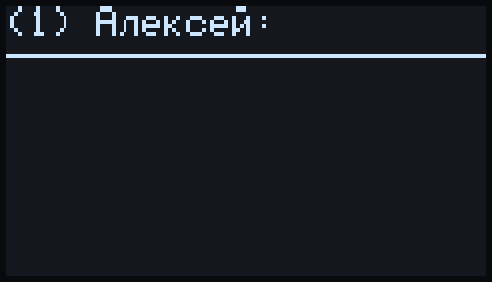

Прошивка companion для **Heltec T114, V3 и V4** на основе [TERMIN36/MeshCore](https://github.com/TERMIN36/MeshCore). Как пользоваться: [README](https://github.com/vladkondratyev/meshcore#readme).

## Отличия от TERMIN36

- **Бегущая строка (Msg scroll).** Новое сообщение проходит через экран крупными точками, затем открывается обычное окно. Включена сразу после прошивки. Выключить: дойти до страницы Msg scroll и сделать долгое нажатие (`Msg scroll: OFF`), выбор сохраняется. Размер точек, скорость и число проходов задаются флагами сборки.
- **Write — сообщение с устройства.** Канал или избранный контакт, готовые фразы или свой текст на клавиатуре одного экрана. Для личных сообщений — отметка `Delivered`.
- **Русский и английский.** При `set lang ru` (по умолчанию) — русская клавиатура и фразы `ок`, `ping`, `да`, `нет`, `привет`, `пока`; при `set lang en` — английские.
- Очередь сообщений для телефона хранится плотнее: около 500 сообщений в той же памяти на T114.

## Какой файл брать

| Плата | Файл |
|---|---|
| Heltec T114 | `Heltec_t114_companion_radio_ble…zip` |
| Heltec V3 | `Heltec_v3_companion_radio_ble…-merged.bin` для первой установки, `.bin` для обновления |
| Heltec V4 | `heltec_v4_companion_radio_ble…-merged.bin` для первой установки, `.bin` для обновления |

Сборки `_ble` — подключение к приложению по Bluetooth, `_usb` — по USB, `_wifi` — по Wi‑Fi (только V3 и V4, у T114 нет Wi‑Fi).

В Wi‑Fi-сборках сеть задаётся при сборке: в готовых файлах это `myssid` / `mypwd`, порт TCP `5000`. Для своей сети соберите прошивку с вашими `WIFI_SSID` и `WIFI_PWD`.
