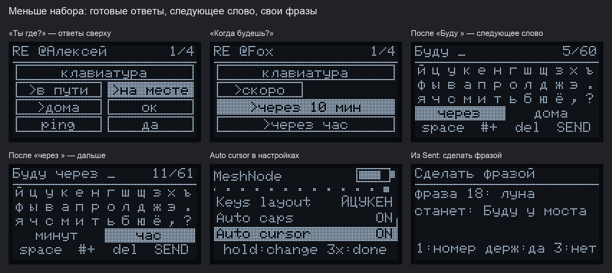
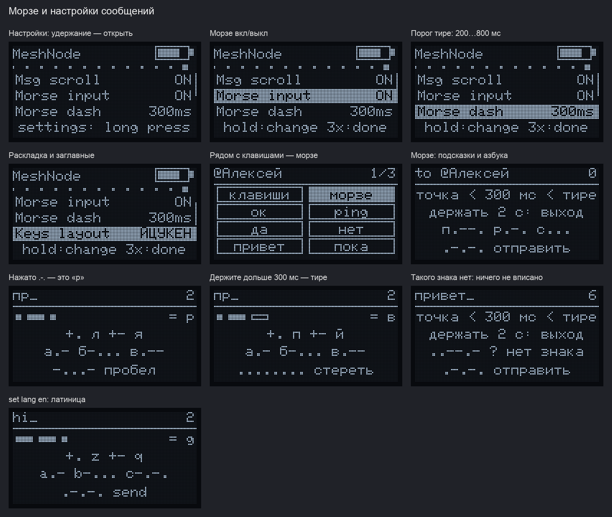

Прошивка companion для **Heltec T114, V3 и V4** на основе [TERMIN36/MeshCore](https://github.com/TERMIN36/MeshCore). Как пользоваться: [README](https://github.com/vladkondratyev/meshcore#readme).

## Что нового в v1.17.1-0.1.10

Меньше набора: устройство всё чаще отвечает само, одним удержанием.

- **Готовые ответы на входящее.** При ответе первыми стоят 2–3 ответа под смысл сообщения, отмечены `>`: «Ты где?» → `в пути`, `на месте`, `дома`; «Когда будешь?» → `скоро`, `через 10 мин`, `через час`; вопрос → `да`, `нет`, `не знаю`. Русский и английский.
- **Следующее слово.** После пробела подсказки предлагают, что обычно идёт дальше: `Буду` → `через`, `дома`. Учатся на ваших отправленных сообщениях.
- **Автокурсор (опция).** После буквы курсор сам встаёт на вероятную следующую букву или на пробел. `Auto cursor` в настройках или `set cursor on`.
- **Фраза из отправленного.** На странице Sent четыре нажатия — «Сделать фразой»: выбираете номер, удержание сохраняет.

Как пользоваться устройством без телефона — в [README](https://github.com/vladkondratyev/meshcore#readme).

## Что было в 0.1.9

- **Ввод азбукой Морзе.** Короткое нажатие — точка, длинное — тире. Азбука по языку: русская при `set lang ru`, латинская при `set lang en`. `.-.-.` — отправить, `-...-` — пробел, 7–8 точек — стереть букву, удержание 2 с — выход. На экране видно, какая буква получится сейчас, что даст ещё точка или тире, и бегущая шпаргалка азбуки. Нераспознанная комбинация не вписывается: показывается `..--.- ? нет знака`.
- **Настройки сообщений на одной странице:** `Msg scroll`, `Morse input`, `Morse dash` (200–800 мс), `Keys layout`, `Auto caps`. Долгое нажатие открывает и меняет, три нажатия закрывают. Или командами `set morse on|off`, `set morse.dash 350`.
- **Клавиатура: новые нажатия.** 1 — вправо, 2 — влево, 3 — вниз, 4 — вверх, 5 — выход (текст остаётся черновиком). Первые секунды в заголовке памятка `1> 2< 3v 4^ 5:выход`, ряд курсора обведён, столбец подчёркнут.
- **Подсказки слов.** Ряд из двух слов над широкими клавишами: набрали `мо` — `можно`, `мост`. Удержание вставляет слово с пробелом. Сначала слова из ваших отправленных сообщений, потом из словаря.
- **Заглавные сами** в начале и после `. ! ?` (`Auto caps`, `set caps off`). **Клавиша `#+`** — цифры и знаки. **Черновики** для четырёх последних адресатов. **Счётчик** `набрано/помещается`.
- **Частотная раскладка** как опция (`Keys layout`, `set kb freq`): частые буквы рядом, ≈11–16% меньше действий.
- **Третий экран фраз:** `погода сегодня`, `погода завтра`, `Курс`, `луна`. Длинная фраза занимает всю строку.
- **Свои фразы командами:** `set phrase 15 погода сегодня`, `set phrase 15` — вернуть стандартную, `phrases 1|2|3` — список с номерами.

## Отличия от TERMIN36

- **Бегущая строка (Msg scroll)** — включена сразу, выключается на странице настроек сообщений (Msg scroll).
- **Write** — сообщение с устройства в канал или избранному контакту: готовые фразы или свой текст, русская и английская клавиатура, отметка `Delivered` для личных, ответ на входящее, список отправленных (Sent).

## Какой файл брать

| Плата | Файл |
|---|---|
| Heltec T114 | `Heltec_t114_companion_radio_ble…zip` |
| Heltec V3 | `Heltec_v3_companion_radio_ble…-merged.bin` для первой установки, `.bin` для обновления |
| Heltec V4 | `heltec_v4_companion_radio_ble…-merged.bin` для первой установки, `.bin` для обновления |

Сборки `_ble` — подключение к приложению по Bluetooth, `_usb` — по USB, `_wifi` — по Wi‑Fi (только V3 и V4).

В Wi‑Fi-сборках сеть задаётся при сборке: в готовых файлах это `myssid` / `mypwd`, порт TCP `5000`.
