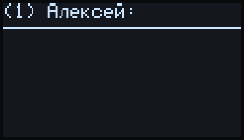
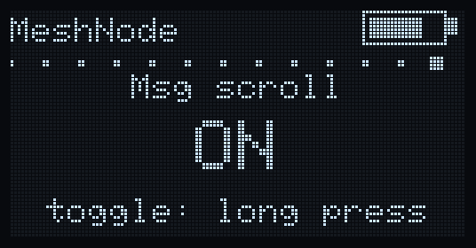
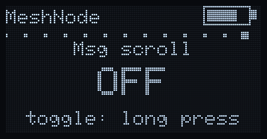
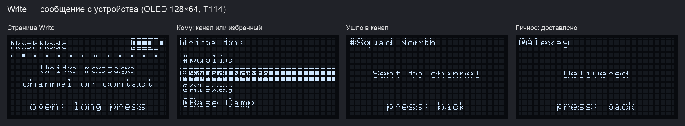
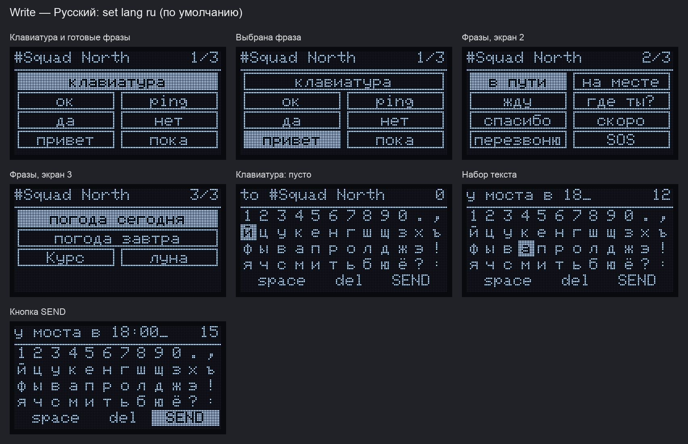
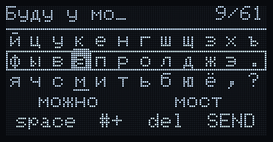
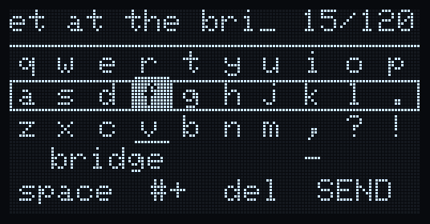
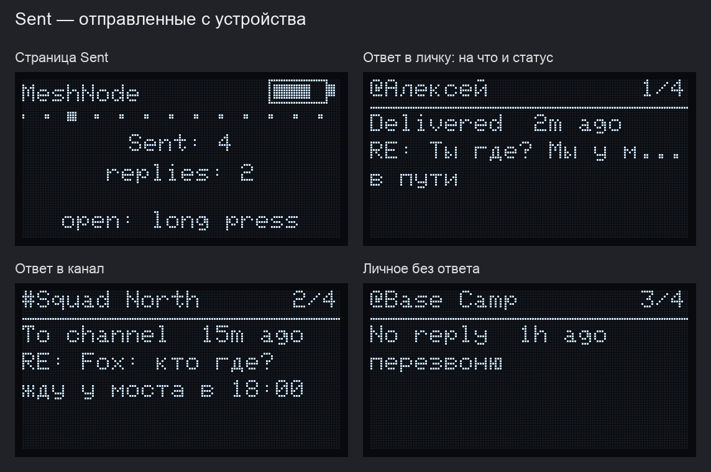
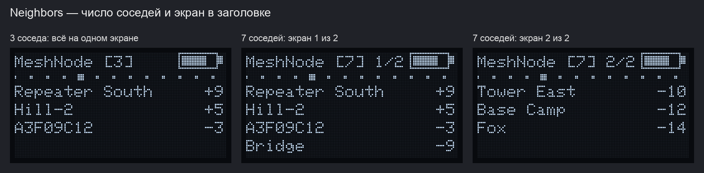

# MeshCore Companion: бегущая строка и сообщения с устройства

Прошивка companion для **Heltec T114**, **Heltec V3** и **Heltec V4**. Сделана на основе форка [TERMIN36/MeshCore](https://github.com/TERMIN36/MeshCore), который в свою очередь основан на [MeshCore](https://github.com/meshcore-dev/MeshCore).

Всё, что умеет прошивка TERMIN36, осталось на месте: русский шрифт, часы, страницы Radio, Power, Scan и Beacon. Их описание — в [README TERMIN36](https://github.com/TERMIN36/MeshCore#readme). Здесь описано только то, чем эта прошивка отличается.

| | TERMIN36 | Этот форк |
|---|:---:|:---:|
| Бегущая строка для входящих сообщений | — | ✅ включена сразу, выключается на устройстве, параметры задаются при сборке |
| Написать и отправить сообщение без телефона | — | ✅ в канал или избранному контакту |
| Готовые фразы | — | ✅ 14 фраз на двух экранах, по-русски или по-английски |
| Русская клавиатура | — | ✅ при `set lang ru` (по умолчанию), английская при `set lang en` |
| Отметка «Delivered» для личных сообщений с устройства | — | ✅ и повтор отправки удержанием, если ответа нет |
| Ответ на входящее с устройства | — | ✅ удержание в окне сообщения, `RE` в заголовке |
| Последние адресаты вверху списка | — | ✅ три последних |
| Отправленные с устройства: кому, на что, статус | — | ✅ страница Sent |
| Число непрочитанных в заголовке | — | ✅ `✉3` рядом с батареей |
| Число соседей и номер экрана в заголовке страницы Neighbors | — | ✅ `Ник [7] 1/2` |
| Сообщение прочитано на устройстве | когда телефон забрал его или по кнопке | только по кнопке |
| Очередь сообщений для телефона | 256 сообщений | ≈500 в той же памяти (T114) |
| Сборки | все платы, все роли | только companion BLE, USB и Wi‑Fi: T114, V3, V4 |

<p align="center">
  
</p>

## Бегущая строка (Msg scroll)

Новое сообщение проходит через экран крупными точками, как на светодиодном табло. Сверху остаётся строка с именем отправителя. Когда текст пройдёт, открывается обычное окно сообщения. Любое нажатие кнопки останавливает строку и сразу показывает сообщение.

<p align="center">
  
</p>

### Как выключить

После прошивки бегущая строка **включена**. Чтобы выключить:

1. Короткими нажатиями листайте страницы до **Msg scroll** — она предпоследняя, перед страницей выключения.
2. Сделайте **долгое нажатие**. На экране появится `Msg scroll: OFF`.

Бегущая строка ничего не отмечает прочитанным: сообщение считается прочитанным только после нажатий в окне сообщения.

Новые сообщения после выключения открываются сразу обычным окном. Включить снова — ещё одно долгое нажатие на той же странице (`Msg scroll: ON`). Выбор сохраняется после перезагрузки. Пока строка включена, каждое новое сообщение будит экран.

<p align="center">
  
  
</p>

### Настройки

Строка понимает латиницу, кириллицу, цифры и знаки препинания. Буквы выводятся заглавными, эмодзи пропускаются.

Вид строки задаётся флагами сборки в `variants/<плата>/platformio.ini`:

| Флаг | По умолчанию | Что задаёт |
|---|---|---|
| `UI_MSG_TICKER` | `1` | Строка есть в прошивке и страница Msg scroll в меню |
| `MSG_TICKER_DEFAULT` | `1` | Включена ли строка после первой прошивки |
| `TICKER_DOT` | `8` | Размер точки в пикселях. На OLED 128×64 сам уменьшается до 7, чтобы буква влезла по высоте |
| `TICKER_DOT_GAP` | `2` | Тёмный зазор между точками |
| `TICKER_STEP_MS` | `50` | Шаг сдвига: 50 мс — около трёх букв в секунду |
| `TICKER_PASSES` | `1` | Сколько раз сообщение проходит по экрану |

Пример: две прокрутки и строка помельче — добавьте флаги в `build_flags` нужной сборки:

```ini
  -D TICKER_DOT=6
  -D TICKER_PASSES=2
```

<p align="center">
  
</p>

## Write: сообщение с устройства

Можно написать и отправить сообщение прямо с устройства, без телефона. Адресат — любой канал устройства или контакт с отметкой «избранный» в приложении MeshCore.

<p align="center">
  
</p>

### Язык клавиатуры и фраз

Раскладка и готовые фразы следуют языку устройства из прошивки TERMIN36. По умолчанию язык русский. Переключается командой в контакте **Console** приложения MeshCore (или в консоли по кабелю):

- `set lang ru` — русская клавиатура (все 33 буквы, по 12 клавиш в ряду) и русские фразы;
- `set lang en` — английская клавиатура и английские фразы.

| Экран | `set lang ru` | `set lang en` |
|---|---|---|
| 1 (с кнопкой клавиатуры) | `ок`, `ping`, `да`, `нет`, `привет`, `пока` | `ok`, `ping`, `yes`, `no`, `hello`, `goodbye` |
| 2 | `в пути`, `на месте`, `жду`, `где ты?`, `спасибо`, `скоро`, `перезвоню`, `SOS` | `on my way`, `arrived`, `waiting`, `where?`, `thanks`, `soon`, `call back`, `SOS` |

Слова `ping` и `SOS` в обоих языках одинаковые. Та же команда переключает день недели на главном экране.

<p align="center">
  
</p>

<p align="center">
  
</p>

### Кому можно отправить

В списке адресатов на странице Write два вида получателей. Выше всех стоят последние три адресата, которым вы писали с устройства, под ними пунктирная линия. Этот список хранится до перезагрузки.

1. **Каналы** — все каналы, настроенные на устройстве (`#public` и добавленные в приложении). Показаны первыми, с `#` перед именем.
2. **Избранные контакты** — только контакты, отмеченные в приложении MeshCore как «избранные» (звёздочка). Показаны после каналов, с `@` перед именем, недавно слышимые выше. Попадают в список собеседники и комнаты (Room Server), до 40 штук. Репитеры и датчики в список не попадают.

Чтобы контакт появился в списке, отметьте его избранным в приложении. Если на устройстве нет ни каналов, ни избранных, страница пишет `No channels or favourites`.

### Как отправить

1. Нажатиями дойдите до страницы **Write**: она сразу после главной.
2. Долгое нажатие открывает список адресатов. Сначала каналы (`#public`, `#…`), затем избранные контакты (`@…`).
3. Выберите адресата долгим нажатием.
4. Выберите готовую фразу — она уходит сразу. Или откройте `клавиатура` (`keyboard`) и наберите свой текст. Фраз 14, они на двух экранах: после последней фразы первого экрана нажатие переводит фокус на второй, номер экрана (`1/2`, `2/2`) виден справа в заголовке.
5. На клавиатуре выберите `SEND`.

После отправки экран показывает результат:

- `Sent to channel` — ушло в канал;
- `Sent (direct)...` или `Sent (flood)...` — личное сообщение в пути;
- `Delivered` — адресат подтвердил получение;
- `No reply` — подтверждение не пришло. Удержание кнопки (`hold: send again`) отправляет тот же текст тому же адресату ещё раз. Если отправка не удалась совсем (`Send failed`), удержание тоже повторяет её.

Через несколько секунд или по нажатию устройство возвращается на главную. После `No reply` экран ждёт 15 секунд, чтобы можно было повторить.

### Ответ на входящее

В окне входящего сообщения **удержание кнопки** открывает Write, где адресат уже выбран: отправитель для личного сообщения, канал для сообщения в канале, комната для сообщения из Room Server. Сразу показаны готовые фразы и `клавиатура`. Отвечать можно и тому, кто не в избранном. Сообщение, на которое вы отвечаете, считается прочитанным.

Пока вы отвечаете, в заголовке перед адресатом стоит `RE`: `RE @Алексей` на экране фраз, на клавиатуре и на экране результата. Если вернуться к списку адресатов и выбрать другого, это уже не ответ, и `RE` пропадает.

<p align="center">
  
</p>

### Клавиатура

Вся клавиатура на одном экране. Текст — до 120 байт: 120 латинских букв или около 60 русских (русская буква занимает 2 байта).

```
set lang ru                    set lang en

1 2 3 4 5 6 7 8 9 0 . ,        1 2 3 4 5 6 7 8 9 0
й ц у к е н г ш щ з х ъ        q w e r t y u i o p
ф ы в а п р о л д ж э !        a s d f g h j k l ?
я ч с м и т ь б ю ё ? :        z x c v b n m , . !
[  space  ][ del ][SEND]       [ space ][ del ][SEND]
```

| Кнопка | На клавиатуре | В списках |
|---|---|---|
| Одно нажатие | Следующая клавиша в ряду | Следующий пункт |
| Два нажатия | Ряд ниже (по кругу, столбец сохраняется) | Предыдущий пункт |
| Три нажатия | Ряд выше | Назад |
| Удержание 0,5 с | Ввести клавишу | Выбрать |
| Четыре нажатия | Выйти без отправки | Выйти на главную |

<p align="center">
  
  
</p>

Отправленные с устройства сообщения не попадают в историю чата в приложении на телефоне. Их видно на странице [Sent](#sent-что-отправлено-с-устройства).

## Sent: что отправлено с устройства

Страница **Sent** стоит сразу после Write. На ней видно, сколько сообщений отправлено с устройства и сколько из них ответы. Удержание открывает список, новые сверху. Для каждого сообщения показано:

- **кому:** `@контакт` или `#канал`, справа номер в списке (`1/4`);
- **статус и время:** `Delivered`, `No reply`, `Waiting...`, `To channel` или `Failed` и сколько прошло (`2m ago`). Статус обновляется сам, даже если подтверждение пришло, когда вы уже ушли с экрана отправки;
- **на что ответ:** строка `RE: …` с началом сообщения, на которое вы отвечали. Для канала там видно и автора: `RE: Fox: кто где?`;
- **текст** сообщения. Длинный текст листается сам.

| Кнопка | В списке Sent |
|---|---|
| Одно нажатие | Более старое |
| Два нажатия | Более новое |
| Удержание | Написать этому же адресату ещё раз |
| Три или четыре нажатия | Выйти на главную |

Хранятся последние 20 сообщений. Список живёт в памяти и очищается при перезагрузке. В приложение на телефоне эти сообщения не попадают.

<p align="center">
  
</p>

## Neighbors: сколько соседей

На странице **Neighbors** рядом с именем устройства в заголовке стоит число соседей в квадратных скобках: `MeshNode [3]`. Если все не помещаются на экран (на OLED — больше четырёх), через пробел показан номер экрана: `[7] 1/2`. Экраны сменяются сами раз в 3 секунды: сначала первые четыре соседа, потом следующие, затем снова с начала.

<p align="center">
  
</p>

## Прочтение сообщений

Сообщение на устройстве считается прочитанным только после нажатий в окне сообщения:

| Кнопка | В окне сообщения |
|---|---|
| Одно нажатие | Прочитано, следующее |
| Два нажатия | Следующая страница длинного сообщения |
| Три нажатия | Удалить сообщение с устройства |
| Удержание | Ответить (см. «Ответ на входящее») |
| Четыре нажатия | Все прочитаны, выйти на главную |

Пока есть непрочитанные, в заголовке страниц справа, рядом с батареей, виден конверт с их числом: `✉3`. Бегущая строка и телефон этого не делают. Если приложение MeshCore подключено и забрало сообщение, на устройстве оно остаётся непрочитанным, окно сообщения не закрывается.

## Сборки

Готовые файлы — на странице [Releases](https://github.com/vladkondratyev/meshcore/releases/latest).

| Плата | Bluetooth | USB | Wi‑Fi |
|---|---|---|---|
| Heltec T114 | `Heltec_t114_companion_radio_ble` | `Heltec_t114_companion_radio_usb` | — |
| Heltec V3 | `Heltec_v3_companion_radio_ble` | `Heltec_v3_companion_radio_usb` | `Heltec_v3_companion_radio_wifi` |
| Heltec V4 | `heltec_v4_companion_radio_ble` | `heltec_v4_companion_radio_usb` | `heltec_v4_companion_radio_wifi` |

Сборки `_ble` подключаются к приложению по Bluetooth, `_usb` — по USB-кабелю, `_wifi` — по Wi‑Fi (TCP). У T114 нет Wi‑Fi, поэтому для него только Bluetooth и USB.

Во всех сборках бегущая строка включена сразу, выключается на странице Msg scroll — см. [Как выключить](#как-выключить).

**Wi‑Fi.** Имя сети и пароль в Wi‑Fi-сборке задаются при сборке, с устройства их не поменять. В готовых файлах стоят `myssid` и `mypwd`, как в оригинальном MeshCore: устройство подключится к сети с этими именем и паролем (например, к точке доступа на телефоне). Чтобы подключить его к своей сети, поменяйте `WIFI_SSID` и `WIFI_PWD` в `variants/heltec_v3/platformio.ini` или `variants/heltec_v4/platformio.ini` и соберите прошивку сами. Приложение подключается к устройству по TCP, порт `5000`.

### Как прошить

| Окончание файла | Когда брать |
|---|---|
| `-merged.bin` | Heltec V3, V4: **первая установка** или переход с другой прошивки. Память стирается, ключи и контакты сбрасываются |
| `.bin` | Heltec V3, V4: **обновление** этой же прошивки. Настройки, контакты и ключи сохраняются |
| `.zip` | Heltec T114: прошивка через DFU |
| `.uf2` | Heltec T114: скопировать на USB-диск, который появляется после двойного нажатия Reset |

1. Подключите устройство USB-кабелем **с передачей данных**.
2. В Chrome или Edge на компьютере откройте [прошивальщик Мешкартеля](https://meshcoretel.ru/ru/flasher) или [flasher.meshcore.io](https://flasher.meshcore.io).
3. Выберите **кастомную прошивку** и скачанный файл.
4. Для `-merged.bin` очистка устройства нужна. Для обычного `.bin` её нужно **выключить**, иначе плата может не загрузиться — тогда прошейте `-merged.bin`.
5. Нажмите «Прошить», выберите COM-порт и дождитесь конца прошивки, не отключая кабель.

Если порта на V3/V4 нет в списке: зажмите **BOOT** (на Heltec V4 это `PRG`/`USER`), нажмите и отпустите **RST**, отпустите BOOT и повторите.

### Собрать самому

```sh
pip install platformio
pio run -e Heltec_t114_companion_radio_ble
```

Картинки экранов в этом README генерирует `tools/screen_render/render_compose.py` (нужен Pillow).

## Лицензия

MIT, как у MeshCore. См. [license.txt](license.txt).
