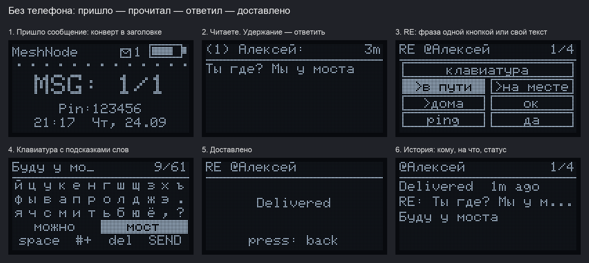
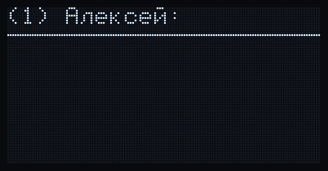
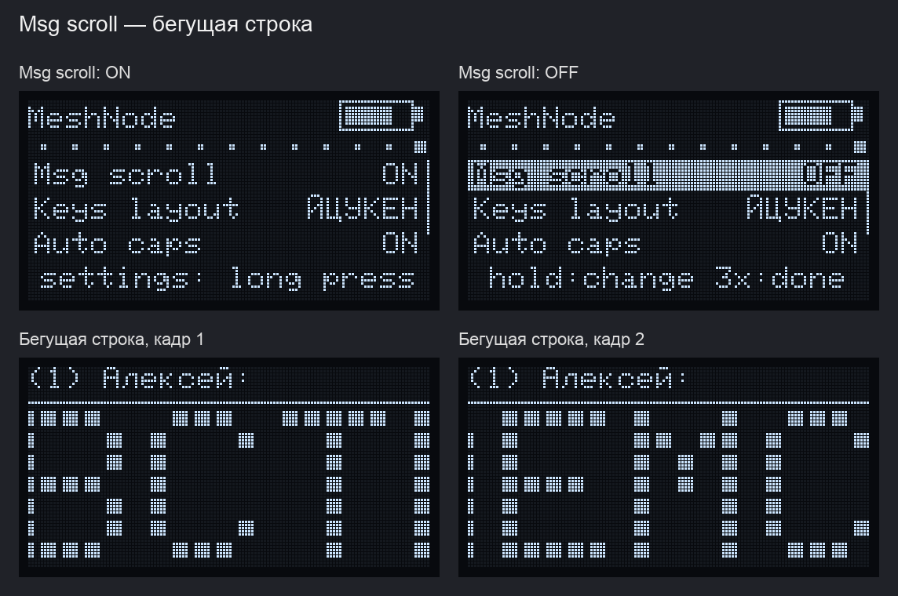
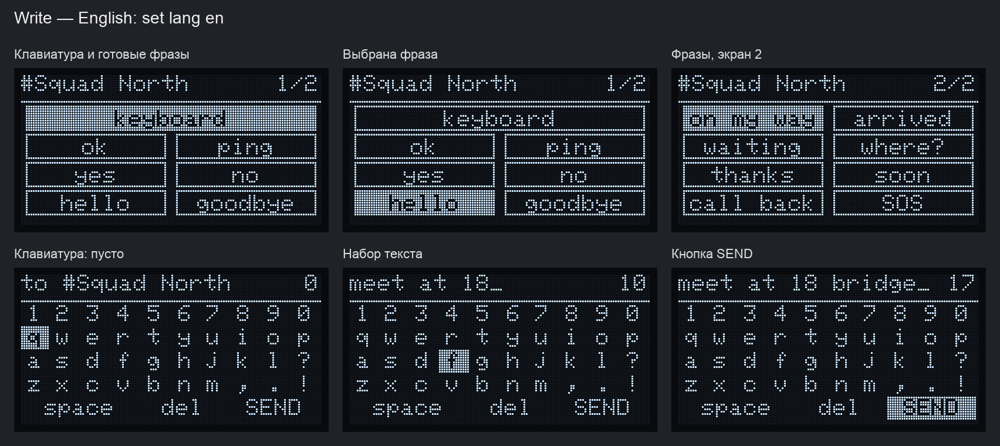
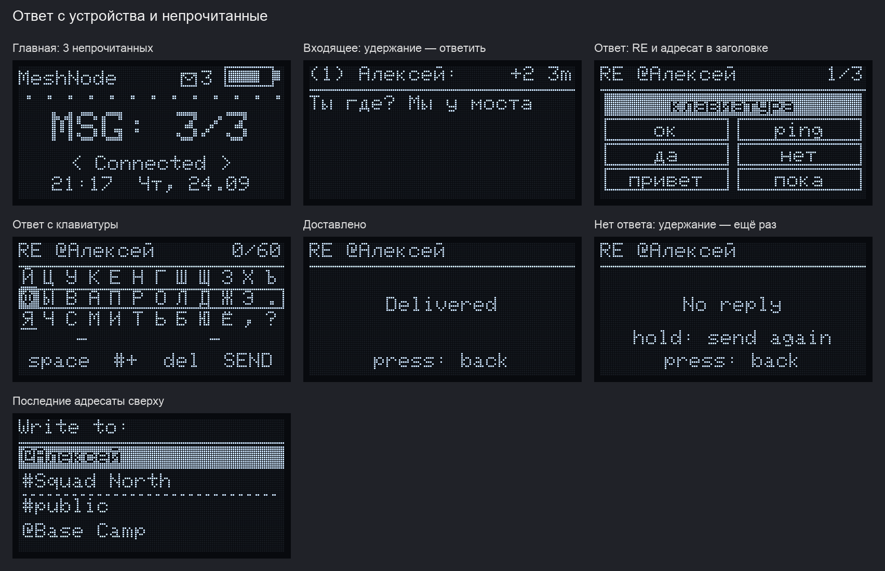
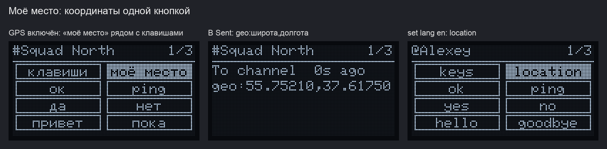
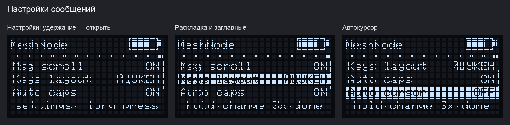

# MeshCore Companion: переписка без телефона

Прошивка companion для **Heltec T114**, **Heltec V3** и **Heltec V4**. Сделана на основе форка [TERMIN36/MeshCore](https://github.com/TERMIN36/MeshCore), который в свою очередь основан на [MeshCore](https://github.com/meshcore-dev/MeshCore).

**Главное: устройство работает само, без телефона.** Обычный companion — это радиомодем для приложения: без телефона он только принимает. С этой прошивкой можно оставить телефон дома, в машине или с разряженной батареей. Сообщения по‑прежнему приходят, их можно прочитать, ответить, написать первым и проверить, дошло ли. Всё это одной кнопкой на самом устройстве.

Телефон при этом никуда не девается. Если приложение подключено, всё работает как раньше, и устройство дополняет телефон, а не заменяет его.

<p align="center">
  
</p>

## Что можно делать без телефона

| Задача | Как это сделано | Подробно |
|---|---|---|
| Узнать, что пришло сообщение | Бегущая строка крупными буквами, конверт с числом непрочитанных в заголовке | [Бегущая строка](#бегущая-строка-msg-scroll), [Прочтение](#прочтение-сообщений) |
| Прочитать | Окно сообщения, длинные листаются сами | [Прочтение](#прочтение-сообщений) |
| Ответить | Удержание в окне сообщения: адресат уже выбран, в заголовке `RE` | [Ответ на входящее](#ответ-на-входящее) |
| Ответить быстро | Готовые ответы под смысл сообщения («Ты где?» → `в пути`), 18 фраз, свои фразы | [Как писать быстрее](#как-писать-быстрее) |
| Написать свой текст | Клавиатура с подсказками слова и следующего слова, заглавными, цифрами и черновиками | [Клавиатура](#клавиатура) |
| Сообщить, где вы | Клавиша «моё место» отправляет координаты GPS одним удержанием | [Моё место](#моё-место-координаты-одной-кнопкой) |
| Написать первым | В канал или избранному контакту, последние адресаты сверху | [Кому можно отправить](#кому-можно-отправить) |
| Убедиться, что дошло | `Delivered` / `No reply` для личных, повтор удержанием | [Как отправить](#как-отправить) |
| Посмотреть, что отправлено | Страница Sent: кому, в какой канал, на что ответ, статус | [Sent](#sent-что-отправлено-с-устройства) |
| Включить насос, свет, ворота | Страница Relays: умные реле по Bluetooth или Wi‑Fi, команда `реле 1 вкл` по mesh | [Реле](#реле-умные-выключатели) |
| Видеть, кто рядом | Neighbors: число соседей и их сигнал | [Neighbors](#neighbors-сколько-соседей) |
| Настроить под себя | Бегущая строка, раскладка, заглавные, автокурсор — в меню устройства | [Как выключить](#как-выключить) |

## Что один раз сделать с телефоном

Устройство пишет тем, кого знает. Поэтому до выхода «в поле» один раз подключите приложение MeshCore и:

1. **Задайте имя и частоты** устройства, как для обычного companion.
2. **Добавьте каналы**, в которые будете писать (`#public` есть сразу). Каналы с секретным ключом добавляются только из приложения.
3. **Отметьте избранными (звёздочкой) контакты**, которым будете писать первым. Отвечать можно любому, кто написал, даже не избранному.
4. По желанию в контакте **Console**: язык (`set lang ru|en`), свои фразы (`set phrase N текст`), время (`set time …`).

Всё остальное — чтение, ответы, новые сообщения, настройки ленты и клавиатуры — дальше делается на устройстве.

## Одна кнопка: шпаргалка

| Где | 1 нажатие | 2 нажатия | 3 нажатия | 4 нажатия | 5 нажатий | Удержание |
|---|---|---|---|---|---|---|
| Страницы меню | следующая | предыдущая | звук вкл/выкл | — | — | открыть / выбрать |
| Окно сообщения | прочитано, следующее | следующая страница | удалить | все прочитаны | — | **ответить** |
| Списки (адресаты, фразы) | следующий | предыдущий | назад | на главную | на главную | выбрать / **отправить фразу** |
| Клавиатура | вправо | влево | вниз | вверх | выход (черновик) | ввести клавишу |
| Sent | старее | новее | выход | **сделать фразой** | выход | написать ещё раз |
| Relays | следующее | предыдущее | выход | выход | выход | вкл/выкл, найти, добавить |
| Настройки сообщений | следующая строка | предыдущая | закрыть | — | — | открыть / изменить |

## Чем отличается от TERMIN36

Всё, что умеет прошивка TERMIN36, осталось на месте: русский шрифт, часы, страницы Radio, Power, Scan и Beacon. Их описание — в [README TERMIN36](https://github.com/TERMIN36/MeshCore#readme). Ниже — только то, что добавлено здесь.

| | TERMIN36 | Этот форк |
|---|:---:|:---:|
| Бегущая строка для входящих сообщений | — | ✅ включена сразу, выключается на устройстве, параметры задаются при сборке |
| Написать и отправить сообщение без телефона | — | ✅ в канал или избранному контакту |
| Готовые фразы | — | ✅ 18 фраз на трёх экранах, по-русски или по-английски, любую можно заменить командой |
| Русская клавиатура | — | ✅ при `set lang ru` (по умолчанию), английская при `set lang en` |
| Подсказки слов, черновики, заглавные, цифры и знаки на клавиатуре | — | ✅ |
| Отправить свои координаты | — | ✅ клавиша «моё место», когда включён GPS |
| Отметка «Delivered» для личных сообщений с устройства | — | ✅ и повтор отправки удержанием, если ответа нет |
| Ответ на входящее с устройства | — | ✅ удержание в окне сообщения, `RE` в заголовке |
| Последние адресаты вверху списка | — | ✅ три последних |
| Отправленные с устройства: кому, на что, статус | — | ✅ страница Sent |
| Число непрочитанных в заголовке | — | ✅ `✉3` рядом с батареей |
| Число соседей и номер экрана в заголовке страницы Neighbors | — | ✅ `Ник [7] 1/2` |
| Сообщение прочитано на устройстве | когда телефон забрал его или по кнопке | только по кнопке |
| Очередь сообщений для телефона | 256 сообщений | ≈500 в той же памяти (T114) |
| Сборки | все платы, все роли | только companion BLE, USB и Wi‑Fi: T114, V3, V4 и ещё 16 плат с экраном и кнопкой |

<p align="center">
  
</p>

## Бегущая строка (Msg scroll)

Новое сообщение проходит через экран крупными точками, как на светодиодном табло. Сверху остаётся строка с именем отправителя. Когда текст пройдёт, открывается обычное окно сообщения. Любое нажатие кнопки останавливает строку и сразу показывает сообщение.

<p align="center">
  
</p>

### Как выключить

После прошивки бегущая строка **включена**. Она выключается на странице настроек сообщений. Там же настраивается клавиатура.

1. Короткими нажатиями листайте страницы до страницы с `Msg scroll`, `Keys layout`, `Auto caps` и `Auto cursor`. Она предпоследняя, перед страницей выключения.
2. **Долгое нажатие** открывает настройки: строка под курсором выделяется.
3. Нажатием дойдите до `Msg scroll` (она первая) и сделайте **долгое нажатие**: `ON` сменится на `OFF`.
4. **Три нажатия** закрывают настройки.

| Кнопка | На странице настроек |
|---|---|
| Долгое нажатие | Открыть настройки, затем изменить строку под курсором |
| Одно нажатие | Следующая строка |
| Два нажатия | Предыдущая строка |
| Три нажатия | Закрыть настройки |

Бегущая строка ничего не отмечает прочитанным: сообщение считается прочитанным только после нажатий в окне сообщения.

Новые сообщения после выключения открываются сразу обычным окном. Выбор сохраняется после перезагрузки. Пока строка включена, каждое новое сообщение будит экран.

<p align="center">
  
  
</p>

### Настройки

Строка понимает латиницу, кириллицу, цифры и знаки препинания. Буквы выводятся заглавными, эмодзи пропускаются.

Вид строки задаётся флагами сборки в `variants/<плата>/platformio.ini`:

| Флаг | По умолчанию | Что задаёт |
|---|---|---|
| `UI_MSG_TICKER` | `1` | Строка есть в прошивке и страница Msg scroll в меню |
| `MSG_TICKER_DEFAULT` | `1` | Включена ли строка после первой прошивки |
| `TICKER_DOT` | `8` | Размер точки в пикселях. На OLED 128×64 сам уменьшается до 7, чтобы буква влезла по высоте |
| `TICKER_DOT_GAP` | `2` | Тёмный зазор между точками |
| `TICKER_STEP_MS` | `50` | Шаг сдвига: 50 мс — около трёх букв в секунду |
| `TICKER_PASSES` | `1` | Сколько раз сообщение проходит по экрану |

Пример: две прокрутки и строка помельче — добавьте флаги в `build_flags` нужной сборки:

```ini
  -D TICKER_DOT=6
  -D TICKER_PASSES=2
```

<p align="center">
  
</p>

## Write: сообщение с устройства

Можно написать и отправить сообщение прямо с устройства, без телефона. Адресат — любой канал устройства или контакт с отметкой «избранный» в приложении MeshCore.

<p align="center">
  
</p>

### Язык клавиатуры и фраз

Раскладка и готовые фразы следуют языку устройства из прошивки TERMIN36. По умолчанию язык русский. Переключается командой в контакте **Console** приложения MeshCore (или в консоли по кабелю):

- `set lang ru` — русская клавиатура (все 33 буквы, по 12 клавиш в ряду) и русские фразы;
- `set lang en` — английская клавиатура и английские фразы.

| Экран | `set lang ru` | `set lang en` |
|---|---|---|
| 1 (с кнопкой клавиатуры) | `ок`, `ping`, `да`, `нет`, `привет`, `пока` | `ok`, `ping`, `yes`, `no`, `hello`, `goodbye` |
| 2 | `в пути`, `на месте`, `жду`, `где ты?`, `спасибо`, `скоро`, `перезвоню`, `SOS` | `on my way`, `arrived`, `waiting`, `where?`, `thanks`, `soon`, `call back`, `SOS` |
| 3 | `погода сегодня`, `погода завтра`, `Курс`, `луна` | `weather today`, `weather tomorrow`, `rate`, `moon` |

Слова `ping` и `SOS` в обоих языках одинаковые. Та же команда переключает день недели на главном экране. Фраза, которая не помещается в половину строки, занимает строку целиком, поэтому `погода сегодня` и `погода завтра` видны полностью.

### Свои фразы

Любую из 18 фраз можно заменить своей. Команды вводятся там же, где `set lang`: в контакте **Console** приложения MeshCore или в консоли по кабелю.

| Команда | Что делает |
|---|---|
| `phrases 1`, `phrases 2`, `phrases 3` | Показать фразы 1–6, 7–12, 13–18 с номерами. Свои отмечены `*` |
| `set phrase 15 погода сегодня` | Заменить фразу № 15 |
| `set phrase 15` | Вернуть фразу № 15 по умолчанию |

Номер фразы — её место по порядку в таблице выше: на экране 1 фразы 1–6, на экране 2 — 7–14, на экране 3 — 15–18. Фраза — до 31 байта: 31 латинская буква или 15 русских. Длиннее — обрежется. Свои фразы хранятся в памяти устройства, переживают перезагрузку и показываются при любом языке вместо стандартных.

Пример: бот в канале понимает команду `wx`. Тогда `set phrase 15 wx`, и на третьем экране первая кнопка отправит `wx`.

<p align="center">
  
</p>

<p align="center">
  
</p>

### Кому можно отправить

В списке адресатов на странице Write два вида получателей. Выше всех стоят последние три адресата, которым вы писали с устройства, под ними пунктирная линия. Этот список хранится до перезагрузки.

1. **Каналы** — все каналы, настроенные на устройстве (`#public` и добавленные в приложении). Показаны первыми, с `#` перед именем.
2. **Избранные контакты** — только контакты, отмеченные в приложении MeshCore как «избранные» (звёздочка). Показаны после каналов, с `@` перед именем, недавно слышимые выше. Попадают в список собеседники и комнаты (Room Server), до 40 штук. Репитеры и датчики в список не попадают.

Чтобы контакт появился в списке, отметьте его избранным в приложении. Если на устройстве нет ни каналов, ни избранных, страница пишет `No channels or favourites`.

### Как отправить

1. Нажатиями дойдите до страницы **Write**: она сразу после главной.
2. Долгое нажатие открывает список адресатов. Сначала каналы (`#public`, `#…`), затем избранные контакты (`@…`).
3. Выберите адресата долгим нажатием.
4. Выберите готовую фразу — она уходит сразу. Или откройте `клавиатура` (`keyboard`) и наберите свой текст. Фраз 18, они на трёх экранах: после последней фразы экрана нажатие переводит фокус на следующий, номер экрана (`1/3`, `2/3`, `3/3`) виден справа в заголовке.
5. На клавиатуре выберите `SEND`.

После отправки экран показывает результат:

- `Sent to channel` — ушло в канал;
- `Sent (direct)...` или `Sent (flood)...` — личное сообщение в пути;
- `Delivered` — адресат подтвердил получение;
- `No reply` — подтверждение не пришло. Удержание кнопки (`hold: send again`) отправляет тот же текст тому же адресату ещё раз. Если отправка не удалась совсем (`Send failed`), удержание тоже повторяет её.

Через несколько секунд или по нажатию устройство возвращается на главную. После `No reply` экран ждёт 15 секунд, чтобы можно было повторить.

### Ответ на входящее

В окне входящего сообщения **удержание кнопки** открывает Write, где адресат уже выбран: отправитель для личного сообщения, канал для сообщения в канале, комната для сообщения из Room Server. Сразу показаны готовые фразы и `клавиатура`. Отвечать можно и тому, кто не в избранном. Сообщение, на которое вы отвечаете, считается прочитанным.

Пока вы отвечаете, в заголовке перед адресатом стоит `RE`: `RE @Алексей` на экране фраз, на клавиатуре и на экране результата. Если вернуться к списку адресатов и выбрать другого, это уже не ответ, и `RE` пропадает.

<p align="center">
  
</p>

### Как писать быстрее

Чем меньше нажатий, тем легче писать одной кнопкой. Четыре помощника:

**1. Готовые ответы на входящее.** Когда вы отвечаете удержанием, устройство смотрит на текст пришедшего сообщения и ставит первыми 2–3 подходящих ответа. Они отмечены `>`, и чтобы отправить, достаточно одного удержания.

| Пришло (есть слово) | Ответы сверху |
|---|---|
| где ты, ты где, куда | `в пути`, `на месте`, `дома` |
| когда, во сколько, долго | `скоро`, `через 10 мин`, `через час` |
| как дела, как ты | `нормально`, `хорошо`, `всё ок` |
| слышишь, связь, приём, ping, тест | `слышу хорошо`, `слышу плохо`, `есть связь` |
| сколько | `мало`, `много`, `не знаю` |
| спасибо | `пожалуйста`, `не за что` |
| привет, добрый | `привет`, `на связи` |
| пока, до встречи | `пока`, `до связи` |
| можно, можешь, будешь, придёшь | `да`, `нет`, `позже` |
| помоги, помощь, SOS | `иду`, `где ты?`, `вызываю помощь` |
| любой вопрос с `?` | `да`, `нет`, `не знаю` |

При `set lang en` то же самое по-английски: «where are you» → `on my way`, `arrived`, `at home` и так далее. Если подходящих слов нет, экран фраз обычный.

**2. Следующее слово.** После пробела в ряду подсказок клавиатуры появляются слова, которые обычно идут дальше: после `Буду` — `через` и `дома`, после `через` — `минут` и `час`. Удержание на слове вставляет его с пробелом, так фразу можно собрать почти целиком из подсказок. Устройство запоминает пары слов из ваших отправленных сообщений и предлагает их первыми.

**3. Автокурсор (опция).** После каждой буквы курсор сам переходит на букву, которой чаще всего продолжается слово. Набрали `пр` — курсор уже на `и`. Если слово, похоже, закончено, курсор встаёт на `space`. Если угадал, до нужной буквы не нужно ни одного перехода. Включается пунктом `Auto cursor` в настройках сообщений или командой `set cursor on`. По умолчанию выключен: к прыгающему курсору нужно привыкнуть.

**4. Своя фраза из отправленного.** То, что часто набираете на клавиатуре, можно сделать фразой прямо с устройства, без консоли:

1. Откройте страницу **Sent** и найдите сообщение нажатиями.
2. Сделайте **четыре нажатия**. Откроется `Сделать фразой`: видно номер фразы, какая там сейчас и какой станет.
3. Нажатиями выберите номер (1–18), **удержание** сохраняет, **три нажатия** отменяют.

Фраза — до 31 байта (15 русских букв): длиннее обрежется, экран об этом предупредит.

<p align="center">
  
</p>

### Клавиатура

Вся клавиатура на одном экране: три ряда букв, ряд из двух подсказок слов и ряд широких клавиш. Текст — до 120 байт: 120 латинских букв или около 60 русских (русская буква занимает 2 байта). Справа в заголовке счётчик `набрано/помещается`, например `9/61`.

```
set lang ru                      set lang en

й ц у к е н г ш щ з х ъ          q w e r t y u i o p
ф ы в а п р о л д ж э .          a s d f g h j k l .
я ч с м и т ь б ю ё , ?          z x c v b n m , ? !
[ слово 1 ] [ слово 2 ]          [ слово 1 ] [ слово 2 ]
[space][#+][ del ][SEND]         [space][#+][del][SEND]
```

| Кнопка | На клавиатуре | В списках |
|---|---|---|
| Одно нажатие | Вправо | Следующий пункт |
| Два нажатия | Влево | Предыдущий пункт |
| Три нажатия | Вниз (по кругу, столбец сохраняется) | Назад |
| Четыре нажатия | Вверх | Выйти на главную |
| Пять нажатий | Выйти, текст остаётся черновиком | Выйти на главную |
| Удержание 0,5 с | Ввести клавишу | Выбрать |

Первые 2,5 секунды после открытия в заголовке видна памятка: `1> 2< 3v 4^ 5:выход`. Строка, где стоит курсор, обведена рамкой, а его столбец подчёркнут в остальных рядах.

**Подсказки слов.** Пока набирается слово, в четвёртом ряду появляются два подходящих слова: набрали `мо` — видно `можно` и `мост`. Удержание на слове заменяет набранное начало этим словом и ставит пробел. Сначала предлагаются слова из сообщений, которые вы уже отправили с устройства (страница Sent), потом из встроенного словаря частых слов: около 230 русских и 135 английских. Подходящих слов нет — в ряду прочерки.

**Заглавные буквы.** Первая буква сообщения и первая буква после `.`, `!` или `?` с пробелом становятся заглавными сами. Буквы на клавишах в этот момент тоже показаны заглавными. Если бот в канале ждёт команду строчными, выключите `Auto caps` в настройках или командой `set caps off`.

**Цифры и знаки.** Цифр на основной раскладке нет: клавиша `#+` переключает три верхних ряда на цифры и знаки `- + = / ( ) @ # % & * _ ! ? : ; " ' ~ $ < > [ ]`. На этой клавише тогда написано `абв` (`abc`); она же возвращает буквы. Точка, запятая и вопрос есть и на буквенной раскладке.

**Черновики.** Если выйти из клавиатуры (пять нажатий, назад к адресатам или на главную), набранный текст сохраняется как черновик для этого адресата. При следующем открытии клавиатуры для того же адресата он вернётся, на экране мелькнёт `Черновик`. Хранятся черновики для четырёх последних адресатов до перезагрузки. После отправки черновик удаляется. Если отправка не удалась, остаётся.

**Частотная раскладка.** Вместо ЙЦУКЕН / QWERTY можно включить раскладку, где частые буквы стоят рядом друг с другом и с пробелом. Это опция `Keys layout` в настройках сообщений или команда `set kb freq` (`set kb std` — обратно). По расчёту на типичном тексте она экономит действия: для русского ≈3,7 вместо ≈4,2 на букву (−11%), для английского ≈3,4 вместо ≈4,1 (−16%). Но к ней нужно привыкнуть, поэтому по умолчанию стоит обычная.

```
частотная ru               частотная en
т а и л я ч ш ф э ж з п    i t s u p ? q k y c
н о е р у б . щ ц , г м    a e o l g . ! v f d
к с в д ь х ? ъ ё ю й ы    h n r w , x z j b m
```

<p align="center">
  
</p>

Отправленные с устройства сообщения не попадают в историю чата в приложении на телефоне. Их видно на странице [Sent](#sent-что-отправлено-с-устройства).

## Моё место: координаты одной кнопкой

Если на плате есть GPS-приёмник и он **включён** (страница GPS в меню устройства), на первом экране фраз вместо одной кнопки `клавиатура` появляются две: `клавиши` и `моё место` (`location` при `set lang en`). GPS выключен или его нет — клавиши `моё место` нет.

1. Откройте Write, выберите адресата или ответьте удержанием на входящее.
2. Нажатием перейдите на `моё место` и сделайте **удержание**.
3. Уходят координаты в виде `geo:55.75210,37.61750`. Приложение MeshCore у получателя показывает их как ссылку на карту.

Если GPS ещё не поймал спутники, ничего не отправляется: на экране мелькнёт `Нет GPS-фикса`. Подождите на открытом месте и попробуйте снова. Отправленные координаты видны на странице Sent, как любое сообщение.

<p align="center">
  
</p>

## Реле: умные выключатели

Устройство может включать и выключать умные реле: насос, свет, обогреватель, ворота. Управлять можно тремя способами:

- **с самого устройства** — страница **Relays** в меню;
- **из другого места по mesh** — сообщение `реле 1 вкл` от доверенного контакта, устройство ответит `реле 1 насос: ВКЛ`;
- **из консоли** — командой `relay 1 on`.

### Какие реле подходят

| Реле | Как подключается | Сборка прошивки | Где брать |
|---|---|---|---|
| **Bluetooth-модули LCTech** на JDY-16 / JDY-33, 1–8 каналов | Bluetooth, напрямую с устройства | `_ble` (ESP32: Heltec V3, V4 и другие) | AliExpress, «Bluetooth relay module LCTech», 300–700 ₽ |
| **Shelly Gen2 / Gen3** (Plus 1, Plus 1PM, Plus 2PM, Mini Gen3, Plus Plug S) | Wi‑Fi, в той же сети, что устройство | `_wifi` | магазины умного дома |
| **Shelly Gen1** (Shelly 1, 1PM, 2.5, Plug) | Wi‑Fi | `_wifi` | |
| **Tasmota** (любое реле с прошивкой Tasmota, например Sonoff Basic) | Wi‑Fi | `_wifi` | |

Не подходят: Sonoff с родной прошивкой eWeLink, Tuya / Smart Life, Xiaomi / Aqara (им нужно облако или шифрование), Bluetooth Mesh-выключатели. На Heltec T114 и других платах на nRF52 реле пока не работают; USB-сборки реле тоже не поддерживают. На Station G2 реле нет: не хватает памяти.

> ⚠️ Реле на 220 В подключает электрик. У Bluetooth-модулей LCTech нет пароля: переключить их может любой, у кого рядом телефон с подходящим приложением. Не ставьте их туда, где это опасно.

### Настройка без телефона (Bluetooth-реле)

1. Включите модуль LCTech и положите рядом с устройством.
2. В меню устройства откройте страницу **Relays** удержанием.
3. Встаньте на `Найти реле` и сделайте **удержание**. Поиск идёт около 5 секунд (`Поиск...`).
4. Внизу появятся найденные модули: `+ JDY-16  -61` (число — уровень сигнала). Встаньте на нужный и сделайте **удержание**: он станет реле с номером и именем `relay N`, канал 1.
5. Теперь **удержание** на реле включает или выключает его. Пока идёт команда, справа `...`; если реле не ответило, мелькнёт ошибка (`not reachable` — далеко или выключено).

Имя и номер канала многоканального модуля меняются командой `relay add` (ниже).

### Настройка из консоли

Команды вводятся в контакте **Console** приложения MeshCore или по кабелю.

| Команда | Что делает |
|---|---|
| `relays` / `relays 2` | Список реле 1–4 / 5–8: номер, имя, тип, канал, адрес, состояние |
| `relay scan`, затем `relay found` | Найти Bluetooth-модули рядом и показать их с номерами |
| `relay add 1 found 2 1 насос` | Сделать реле 1 из найденного модуля № 2, канал 1, имя «насос» |
| `relay add 1 lctech AA:BB:CC:DD:EE:FF 2 свет` | Реле 1 — модуль LCTech по адресу, канал 2 |
| `relay add 2 shelly 192.168.1.50 1 бойлер` | Реле 2 — Shelly Gen2/Gen3 по IP, канал 1 |
| `relay add 3 shelly1 192.168.1.51 1 ворота` | Shelly Gen1 |
| `relay add 4 tasmota 192.168.1.52 1 свет` | Tasmota |
| `relay del 3` | Удалить реле 3 |
| `relay 1 on` / `relay 1 off` / `relay 1 toggle` | Переключить |

Имя — до 15 байт (7 русских букв или 15 латинских). Реле может быть до 8. Для Wi‑Fi реле устройство должно быть в той же сети (Wi‑Fi-сборка подключается к сети, заданной при сборке, см. [Сборки](#сборки)), а на Shelly и Tasmota не должен стоять пароль на веб-интерфейс.

### Управление по mesh

По умолчанию сообщения реле не трогают. Чтобы разрешить:

1. `relay allow Алексей` — разрешить контакту (по началу имени). Можно до 4 контактов. `relay allow` без имени покажет список, `relay deny Алексей` — убрать.
2. `relay mesh on` — включить управление по сообщениям (`relay mesh off` — выключить).

Теперь разрешённый контакт пишет устройству **личное** сообщение:

| Сообщение | Что будет |
|---|---|
| `реле` | Ответ со списком: `реле 1 насос: ВКЛ; реле 2 свет: ВЫКЛ` |
| `реле 1 вкл`, `реле насос вкл` | Включить и ответить `реле 1 насос: ВКЛ` |
| `реле 1 выкл` | Выключить |
| `реле 1 перекл` | Переключить |
| `реле 1` или `реле 1 ?` | Ответить состоянием |

По-английски так же: `relay 1 on`, `relay pump off`. Сообщения от остальных контактов и из каналов реле не переключают и ответа не получают. Если реле не ответило, придёт `реле 1: not reachable`.

Состояние (`ВКЛ` / `ВЫКЛ`) — то, что устройство само установило последним. Если реле переключили кнопкой на нём или из другого приложения, устройство этого не узнает, пока не переключит его само; до первого переключения состояние — `?`.

<p align="center">
  
</p>

Источники: [Shelly — Bluetooth и RPC](https://shelly-api-docs.shelly.cloud/gen2/Components/SystemComponents/BLE), [Shelly — протокол RPC](https://shelly-api-docs.shelly.cloud/gen2/General/RPCProtocol), [инструкция Bluetooth-реле LC Technology](https://manuals.plus/lc-technology/5v-bluetooth-relay-module-bluetooth-remote-control-switch-manual), [JDY-16](https://github.com/fawno/ATORCH-HiDANCE/blob/master/docs/modules/JDY-16).

## Настройки сообщений

Бегущая строка и клавиатура настраиваются на одной странице меню устройства — той, где `Msg scroll`. Удержание открывает настройки, нажатие переходит к следующей строке, удержание меняет значение, три нажатия закрывают. На экране видно три строки из четырёх, список прокручивается за курсором.

| Настройка | На устройстве | Команда | По умолчанию |
|---|---|---|---|
| Бегущая строка | `Msg scroll` | — | включена |
| Раскладка | `Keys layout` | `set kb std\|freq` | ЙЦУКЕН / QWERTY |
| Заглавные | `Auto caps` | `set caps on\|off` | включены |
| Автокурсор | `Auto cursor` | `set cursor on\|off` | выключен |

<p align="center">
  
</p>

## Sent: что отправлено с устройства

Страница **Sent** стоит сразу после Write. На ней видно, сколько сообщений отправлено с устройства и сколько из них ответы. Удержание открывает список, новые сверху. Для каждого сообщения показано:

- **кому:** `@контакт` или `#канал`, справа номер в списке (`1/4`);
- **статус и время:** `Delivered`, `No reply`, `Waiting...`, `To channel` или `Failed` и сколько прошло (`2m ago`). Статус обновляется сам, даже если подтверждение пришло, когда вы уже ушли с экрана отправки;
- **на что ответ:** строка `RE: …` с началом сообщения, на которое вы отвечали. Для канала там видно и автора: `RE: Fox: кто где?`;
- **текст** сообщения. Длинный текст листается сам.

| Кнопка | В списке Sent |
|---|---|
| Одно нажатие | Более старое |
| Два нажатия | Более новое |
| Удержание | Написать этому же адресату ещё раз |
| Четыре нажатия | Сделать фразой (см. [Как писать быстрее](#как-писать-быстрее)) |
| Три или пять нажатий | Выйти на главную |

Хранятся последние 20 сообщений. Список живёт в памяти и очищается при перезагрузке. В приложение на телефоне эти сообщения не попадают.

<p align="center">
  
</p>

## Neighbors: сколько соседей

На странице **Neighbors** рядом с именем устройства в заголовке стоит число соседей в квадратных скобках: `MeshNode [3]`. Если все не помещаются на экран (на OLED — больше четырёх), через пробел показан номер экрана: `[7] 1/2`. Экраны сменяются сами раз в 3 секунды: сначала первые четыре соседа, потом следующие, затем снова с начала.

<p align="center">
  
</p>

## Прочтение сообщений

Сообщение на устройстве считается прочитанным только после нажатий в окне сообщения:

| Кнопка | В окне сообщения |
|---|---|
| Одно нажатие | Прочитано, следующее |
| Два нажатия | Следующая страница длинного сообщения |
| Три нажатия | Удалить сообщение с устройства |
| Удержание | Ответить (см. «Ответ на входящее») |
| Четыре нажатия | Все прочитаны, выйти на главную |

Пока есть непрочитанные, в заголовке страниц справа, рядом с батареей, виден конверт с их числом: `✉3`. Бегущая строка и телефон этого не делают. Если приложение MeshCore подключено и забрало сообщение, на устройстве оно остаётся непрочитанным, окно сообщения не закрывается.

## Сборки

Готовые файлы — на странице [Releases](https://github.com/vladkondratyev/meshcore/releases/latest).

Основные платы — на них прошивка делалась и проверялась:

| Плата | Bluetooth | USB | Wi‑Fi |
|---|---|---|---|
| Heltec T114 | `Heltec_t114_companion_radio_ble` | `Heltec_t114_companion_radio_usb` | — |
| Heltec V3 | `Heltec_v3_companion_radio_ble` | `Heltec_v3_companion_radio_usb` | `Heltec_v3_companion_radio_wifi` |
| Heltec V4 | `heltec_v4_companion_radio_ble` | `heltec_v4_companion_radio_usb` | `heltec_v4_companion_radio_wifi` |

**Другие платы с экраном и одной кнопкой.** Всё работает так же: бегущая строка, Write, готовые ответы, Sent, настройки, а на платах с GPS — «моё место». Эти сборки собираются автоматически, но на самих платах не проверялись. Если что-то не так — напишите в Issues.

| Плата | Bluetooth | USB | Wi‑Fi |
|---|---|---|---|
| Heltec V2 | `Heltec_v2_companion_radio_ble` | `Heltec_v2_companion_radio_usb` | `Heltec_v2_companion_radio_wifi` |
| Heltec V4 R8 (OLED) | `heltec_v4_r8_companion_radio_ble` | `heltec_v4_r8_companion_radio_usb` | `heltec_v4_r8_companion_radio_wifi` |
| Heltec V4 R8 (TFT) | `heltec_v4_r8_tft_companion_radio_ble` | `heltec_v4_r8_tft_companion_radio_usb` | `heltec_v4_r8_tft_companion_radio_wifi` |
| Heltec Wireless Tracker | `Heltec_Wireless_Tracker_companion_radio_ble` | `Heltec_Wireless_Tracker_companion_radio_usb` | — |
| Heltec Tracker V2 | `heltec_tracker_v2_companion_radio_ble` | `heltec_tracker_v2_companion_radio_usb` | `heltec_tracker_v2_companion_radio_wifi` |
| Heltec T190 | `Heltec_T190_companion_radio_ble_` | `Heltec_T190_companion_radio_usb_` | — |
| LilyGO T3S3 SX1262 | `LilyGo_T3S3_sx1262_companion_radio_ble` | `LilyGo_T3S3_sx1262_companion_radio_usb` | — |
| LilyGO T3S3 SX1276 | `LilyGo_T3S3_sx1276_companion_radio_ble` | `LilyGo_T3S3_sx1276_companion_radio_usb` | — |
| LilyGO T-Beam SX1262 | `Tbeam_SX1262_companion_radio_ble` | — | — |
| LilyGO T-Beam SX1276 | `Tbeam_SX1276_companion_radio_ble` | — | — |
| LilyGO T-Beam S3 Supreme | `T_Beam_S3_Supreme_SX1262_companion_radio_ble` | — | `T_Beam_S3_Supreme_SX1262_companion_radio_wifi` |
| LilyGO T-LoRa V2.1-1.6 | — | `LilyGo_TLora_V2_1_1_6_companion_radio_usb` | `LilyGo_TLora_V2_1_1_6_companion_radio_wifi` |
| RAK4631 (с OLED-модулем) | `RAK_4631_companion_radio_ble` | `RAK_4631_companion_radio_usb` | — |
| Station G2 | — | `Station_G2_companion_radio_usb` | `Station_G2_companion_radio_wifi` |
| Nano G2 Ultra | `Nano_G2_Ultra_companion_radio_ble` | `Nano_G2_Ultra_companion_radio_usb` | — |
| Elecrow ThinkNode M2 | `ThinkNode_M2_companion_radio_ble` | `ThinkNode_M2_companion_radio_usb` | `ThinkNode_M2_companion_radio_wifi` |
| Seeed Xiao S3 + Wio SX1262 | `Xiao_S3_WIO_companion_radio_ble` | `Xiao_S3_WIO_companion_radio_usb` | `Xiao_S3_WIO_companion_radio_wifi` |

У T-LoRa V2.1 и Station G2 нет Bluetooth-сборки: с новыми функциями она не помещается в память этих плат. Платы на nRF52 (T114, RAK4631, Nano G2 Ultra) прошиваются файлом `.uf2` или `.zip`, остальные (ESP32) — `.bin` и `-merged.bin`, как V3 и V4.

**Какие платы не подходят пока.** Платы с e-ink экраном (Heltec Wireless Paper, E213, E290, T-Echo, ThinkNode M1/M5, Mesh Pocket): клавиатуре нужен быстрый экран. Платы с джойстиком или трекболом (Wio Tracker L1, T-Deck): у них другое управление, под него нужна своя схема кнопок. На T-Deck есть настоящая клавиатура, для него можно сделать отдельный ввод.

Сборки `_ble` подключаются к приложению по Bluetooth, `_usb` — по USB-кабелю, `_wifi` — по Wi‑Fi (TCP). У T114 и плат на nRF52 нет Wi‑Fi.

Во всех сборках бегущая строка включена сразу, выключается на странице Msg scroll — см. [Как выключить](#как-выключить).

**Wi‑Fi.** Имя сети и пароль в Wi‑Fi-сборке задаются при сборке, с устройства их не поменять. В готовых файлах стоят `myssid` и `mypwd`, как в оригинальном MeshCore: устройство подключится к сети с этими именем и паролем (например, к точке доступа на телефоне). Чтобы подключить его к своей сети, поменяйте `WIFI_SSID` и `WIFI_PWD` в `platformio.ini` своей платы (например, `variants/heltec_v3/platformio.ini`) и соберите прошивку сами. Приложение подключается к устройству по TCP, порт `5000`.

### Как обновить

Если на устройстве уже стоит эта прошивка (любая версия `v1.17.1-0.1.x`), обновление не трогает контакты, каналы, ключи, имя, частоты, язык и свои фразы.

**Heltec T114 — копированием файла:**

1. Скачайте из [последнего релиза](https://github.com/vladkondratyev/meshcore/releases/latest) файл `Heltec_t114_companion_radio_ble-….uf2` (или `_usb`, если подключаетесь к телефону кабелем).
2. Подключите плату к компьютеру кабелем **с передачей данных** и **дважды быстро нажмите Reset**.
3. На компьютере появится USB-диск. Скопируйте на него файл `.uf2`.
4. Плата сама перезагрузится с новой версией.

**Heltec V3 / V4 — через браузер:**

1. Скачайте из [последнего релиза](https://github.com/vladkondratyev/meshcore/releases/latest) файл **без** `-merged`, например `Heltec_v3_companion_radio_ble-….bin` или `heltec_v4_companion_radio_ble-….bin`.
2. В Chrome или Edge откройте [flasher.meshcore.io](https://flasher.meshcore.io) или [прошивальщик Мешкартеля](https://meshcoretel.ru/ru/flasher).
3. Выберите **кастомную прошивку** и скачанный файл. **Очистку устройства (erase) выключите.**
4. Нажмите «Прошить», выберите COM-порт и дождитесь конца, не отключая кабель.

Если порта на V3/V4 нет в списке: зажмите **BOOT** (на Heltec V4 это `PRG`/`USER`), нажмите и отпустите **RST**, отпустите BOOT и повторите. Если после обновления плата не загружается, прошейте файл с `-merged` — но он стирает память, и контакты, каналы и ключи придётся настроить заново.

**После обновления:**

- Проверьте версию: в приложении MeshCore напишите `ver` в контакте **Console**.
- Новые настройки приходят со значениями по умолчанию: `Auto caps` — включено, `Auto cursor` — выключено, `Keys layout` — ЙЦУКЕН. Поменять — на странице настроек сообщений, см. [Как выключить](#как-выключить).
- Список Sent, черновики и последние адресаты хранятся только в памяти и после прошивки, как после любой перезагрузки, начинаются с нуля.

### Первая установка

| Окончание файла | Когда брать |
|---|---|
| `-merged.bin` | Heltec V3, V4: **первая установка** или переход с другой прошивки. Память стирается, ключи и контакты сбрасываются |
| `.bin` | Heltec V3, V4: **обновление** этой же прошивки (см. выше) |
| `.uf2` | Heltec T114: скопировать на USB-диск, который появляется после двойного нажатия Reset. Подходит и для установки, и для обновления |
| `.zip` | Heltec T114: прошивка через DFU в прошивальщике |

1. Подключите устройство USB-кабелем **с передачей данных**.
2. В Chrome или Edge на компьютере откройте [прошивальщик Мешкартеля](https://meshcoretel.ru/ru/flasher) или [flasher.meshcore.io](https://flasher.meshcore.io).
3. Выберите **кастомную прошивку** и скачанный файл. Для `-merged.bin` очистку устройства включите.
4. Нажмите «Прошить», выберите COM-порт и дождитесь конца прошивки, не отключая кабель.
5. Подключите приложение MeshCore и сделайте шаги из раздела [Что один раз сделать с телефоном](#что-один-раз-сделать-с-телефоном).

### Собрать самому

```sh
pip install platformio
pio run -e Heltec_t114_companion_radio_ble
```

Картинки экранов в этом README генерирует `tools/screen_render/render_compose.py` (нужен Pillow).

## Лицензия

MIT, как у MeshCore. См. [license.txt](license.txt).
